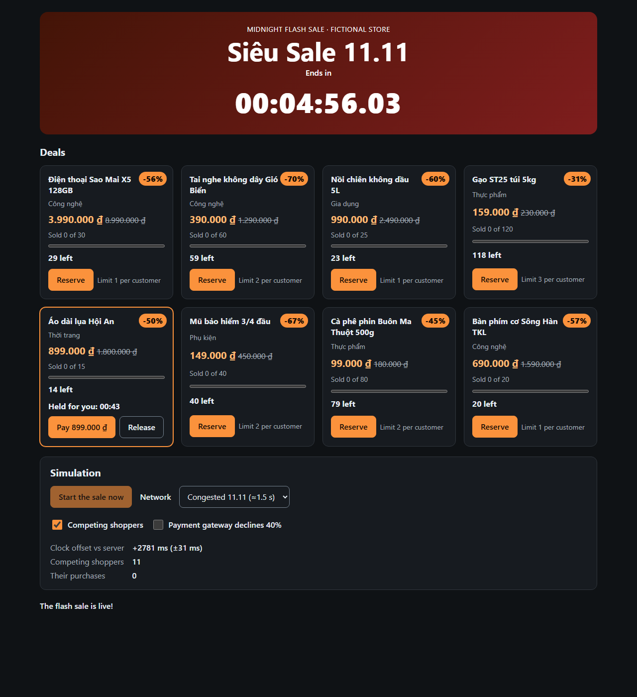
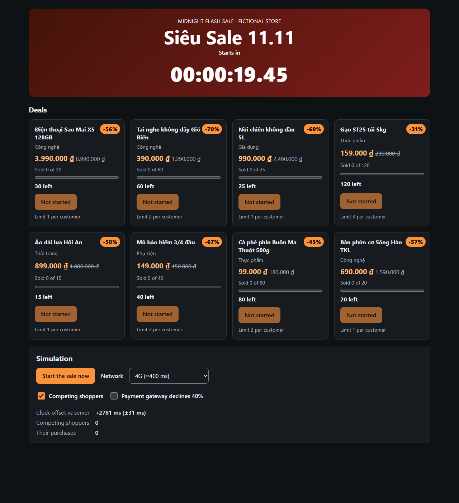

# Lab 02 · Homework 3: High-Concurrency Flash-Sale E-Commerce Engine

A Vietnam **11.11 midnight flash-sale** simulation (fictional store, no real brands). It has a **zero-drift
millisecond countdown** synchronised to server time, and an **optimistic inventory-lock state machine**
(reserve → TTL lock → checkout) that never oversells while thousands of simulated shoppers compete for the same
stock. Built on the Lab 02 Mini-React engine.

| Evidence | Result |
|----------|--------|
| Countdown error vs true time in Chrome, through a 700 ms long task and a 3 s main-thread stall | **≤ 15 ms**, never accumulating |
| Naive `setInterval` countdown, same conditions (baseline) | **+4 238 ms** drift |
| Device clock deliberately 2 750 ms off → NTP-style sync | **+2 781 ms ± 31 ms** recovered |
| Frame rate while re-rendering every centisecond | **61 fps**, 0 long tasks |
| 1 000 simultaneous reservations for 3 units | exactly **3** locks |
| 5-minute sale × 3 seeds, > 4 000 shoppers each, random latency and payment declines | **0 oversold**, `sold + locked + available = stock` at every update |
| Lighthouse Accessibility / Best Practices | **100 / 100** ([report](docs/lighthouse/report.html)) |
| AI failure audit | **7 real flaws** + 1 measured baseline ([AI_FAILURE_AUDIT.md](AI_FAILURE_AUDIT.md)) |
| Tests | **240 passing** |
| Commits | 14 atomic Conventional Commits (minimum required: 8) |



- Rules: [project-rules.md](project-rules.md)
- Work breakdown: [TASK_DECOMPOSITION.md](TASK_DECOMPOSITION.md)
- AI failure audit: [AI_FAILURE_AUDIT.md](AI_FAILURE_AUDIT.md)

## Run

```bash
npm install
npm run dev        # the sale starts 20 s after load (or press "Start the sale now")
npm test           # 240 tests with fake clocks, manual frames and controllable network
npm run typecheck
```

The **Simulation** panel switches network latency (80 ms / 400 ms / 1.5 s), competing shoppers and a 40 %
payment-decline rate, and shows the measured clock offset.

## Zero-drift time (`src/sale/time.ts`)

```
device clock (2.75 s off) ──► estimateServerOffset (5 round trips, keep fastest) ──► synced clock
                                                                                       │
requestAnimationFrame ──► createTicker: read synced clock, emit `now` when the visible bucket changes
                                                                                       │
                          phase = salePhase(schedule, now)     banner = target − now     hold = expiresAt − now
```

- **No accumulation:** time is never "counted" by adding tick durations. Each frame recomputes
  `target − now()`, so late, dropped or throttled frames cannot add error. The slide's
  `createAntiDriftTimer(durationMs, onTick)` is kept as a thin wrapper over `createCountdown`.
- **Server time:** the device clock is corrected NTP-style. Each sample assumes the server read its clock at the
  middle of the round trip, and the fastest sample is kept, with an error bound of ±RTT/2.
- **One time source:** a single ticker drives one `now` state, at 10 ms while anything counts down and 1 s
  otherwise. Phase, banner and every hold timer are *derived* from it, so they can never disagree. (An early draft
  used a separate `setTimeout` for hold expiry; see [Flaw 4](AI_FAILURE_AUDIT.md#flaw-4--hold-expiry-on-a-second-independent-time-source).)
- **Background tabs:** rAF pauses. On the first frame back everything is recomputed from the clock;
  `createCountdown` also resyncs on `visibilitychange`.
- **Renders only on visible change:** onTick fires only when the displayed centisecond changes.

## Sale phase machine (`src/sale/phase.ts`)

`UPCOMING → LIVE → ENDED`, derived from server time and the schedule on every read (never stored), so a
phase cannot be stale, skipped or reached out of order. `nextElevenEleven()` gives 11/11 00:00 in Vietnam (UTC+7).

## Inventory server (`src/sale/server.ts`)

An in-memory backend with simulated latency. Once a call "arrives", its check-and-update runs synchronously,
i.e. **atomically**, the same guarantee a DB transaction gives.

- **Reservations are TTL locks:** phase check, per-customer limit (across locks *and* purchases), availability.
- **Expired locks return stock:** they are swept on every call, and by one timer re-armed at the earliest
  expiry, so units reappear and are pushed to clients with no traffic.
- **Idempotent checkout:** the same key always returns the same order, so double submits and retries charge
  once. A declined payment keeps the lock, so the user can retry before it expires.
- **Invariant `sold + locked ≤ stock`:** asserted after every mutation (throws `InvariantViolation`).
- **Competing shoppers** (`src/sale/bots.ts`): seeded, deterministic. They prefer bigger discounts and either
  pay or abandon (letting their locks expire).

## Optimistic inventory-lock machine (`src/sale/lock-machine.ts`)

```
IDLE ─RESERVE─► RESERVING ─RESERVE_OK─► RESERVED ─CHECKOUT─► CHECKING_OUT ─PAID─► PURCHASED
 ▲    (shown −1)     │                    │   ▲                  │
 │                   ├─SOLD_OUT─► SOLD_OUT│   └──DECLINED (notice)┤
 │                   └─other─► FAILED     ├─EXPIRE(timer)─► EXPIRED ◄─EXPIRE(server only)
 └───────────── RELEASE / RETRY ──────────┘
```

- **Optimistic:** the unit disappears the moment the user clicks (`displayedAvailable = server.available − pending`)
  and rolls back automatically if the server refuses.
- **Same object for ignored events:** double clicks, stale responses, and expiry of a different lock return the
  *same* object, so nothing re-renders and nothing is submitted twice.
- **Only the server expires a checkout:** a client timer cannot abandon a checkout in flight. Clocks agree only
  to ±RTT/2.
- **Cancel during a reservation:** a success that arrives afterwards is **released immediately**, so the unit is
  not left locked out of the sale for the TTL.

## Accessibility & semantics

- **Landmarks and elements:** `<main>`, `<header>`, `<section>`, `<article>` per product, `<meter>` with a
  `<label>`, `<time datetime>`, `<del>` for the old price, `lang="vi"` on Vietnamese names. Zero `<div>`/`<span>`.
- **Countdown:** `role="timer"` (not a chatty live region). Phase changes and payment problems are announced via
  `role="status"` / `role="alert"`.
- **Controls:** `aria-disabled` rather than `disabled`, so focus is never dropped. Every control is labelled,
  targets are ≥ 44 px, and tabular digits stop the countdown jittering.

## How it was verified

1. `npm test`: time (fake clock, janky and throttled frames), phases, server (1 000-way race, TTL, idempotency,
   dispose), bot stress (3 seeds × 5 minutes), lock machine (full transition table), reservation hook (optimistic
   rollback, double clicks, cancel race, expiry), storefront checkpoint, plus the engine suites.
2. [`scripts/browser-audit.mjs`](scripts/browser-audit.mjs) in real Chrome through the DevTools Protocol:
   - drift sampling against true `Date.now()` through a long task and a stall, with a naive baseline injected
     alongside;
   - fps and long tasks;
   - optimistic stock;
   - a full purchase with a double-clicked Pay button;
   - competing shoppers with an oversell check.

   Raw output: [docs/browser-audit.json](docs/browser-audit.json).
3. Lighthouse 13 on the production build: 100 / 100.


